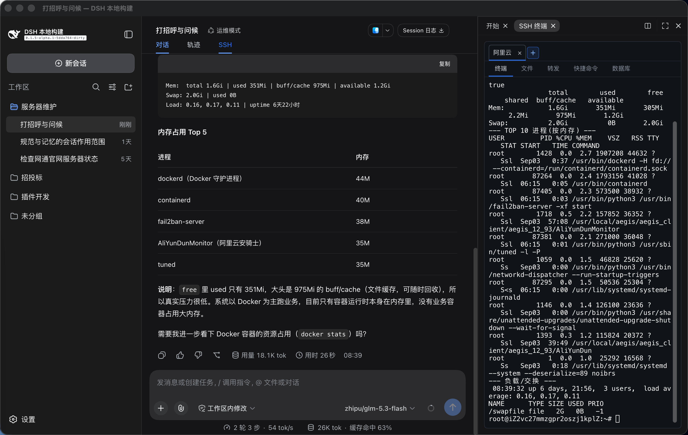
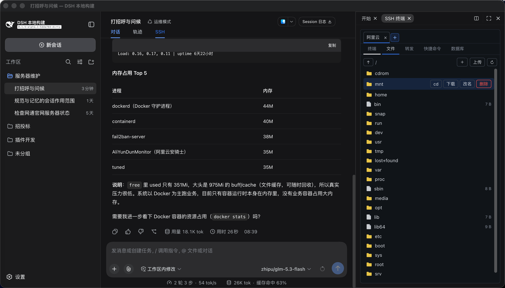

[中文](./README.md) · **English**

---

# DSH SSH Ops


[](https://www.dsh.so/artifact/dsh-ssh-ops/)
[](https://www.dsh.so/artifact/dsh-ssh-ops/?ref=badge-install)
[](https://dsh-plugin.org/plugins/caoyiwei850/dsh-ssh-ops)

> **v0.4.8** adds encrypted server configuration export and import for migration between computers, plus SSH terminal appearance settings and optional semantic text highlighting. Requires DSH 0.2.0 or later. See the [release notes](https://github.com/caoyiwei850/dsh-ssh-ops/releases/tag/v0.4.8).

> An SSH operations plugin for DeepSeek Harness: drive the current server from the main conversation while keeping a real interactive terminal on the right, with built-in file management, port forwarding, and database management.

📖 **New here? Start with the [Product Guide](./docs/product-guide.en.md)** — a ten-minute quick start, a feature walkthrough, the security model, and ready-made recipes.

> **v0.4.7** adds verified streaming downloads with reconnect and optional restart recovery, editor change previews and backup restore, fixes session-log redaction and SFTP deletion target handling, and updates dependencies. Restart recovery is disabled by default and stores unfinished data unencrypted in browser-local storage. The new Desktop interface flows have not yet been fully validated interactively.

> **v0.4.5**: adds pipelined single-file uploads with AI task progress, cancellation, verified in-process resume, and remote integrity checks before committing. Fixes `ssh2` import compatibility on affected hosts, contains unexpected auto-reconnect failures, fills in the English tool documentation, and clarifies when DSH registry plugin updates apply. See [CHANGELOG.md](./CHANGELOG.md).

> **v0.4.4**: the file panel gains **remote file search** and a **transfer task list** (upload progress, cancel, failure cleanup); the in-plugin one-click updater is removed in favor of host plugin management and manual update guidance (protects link-mounted dev installs from silent overwrites); adapts to the new host settings icon slot and fixes blank panels when optional host services are absent. See [CHANGELOG.md](./CHANGELOG.md).

> **Updates:** The settings page provides update guidance. Use the DSH Plugins page for registry installations; update local links in their source directory. The plugin no longer installs updates itself.

## Compatibility

- **Target host**: the DSH Desktop / Web Profile, declared via `engines.dsh` as the unbounded range `>=0.2.0` — hosts since 0.2.1-alpha.4 evaluate plugin compatibility by this field first (`includePrerelease` semantics; `engines.dsh` alone decides, peers no longer participate in the gate), covering host versions from `0.2.0` onward (prerelease handling depends on the host), so host upgrades require no release follow-up. The four official-package `peerDependencies` retain their own compatibility ranges and continue to serve the npm install-time role. Validated on the `0.2.0-rc.2` desktop build. The plugin uses DSH's bundled Node.js runtime and does not require a system `ssh`, `sftp`, or standalone Node.js installation.
- **Current right Sidebar (required)**: the host must supply both `sidebarRightTabs` and `sidebarRight`; SSH then runs as an official right-Sidebar tab and uses the host's split, resize, and fullscreen behavior. Hosts without those APIs no longer get a floating-panel fallback (removed): the host half (agent SSH/SFTP/database tools) keeps working, but no terminal UI is shown.
- **Interface language**: follows the host language automatically (中文 / English), repainting on live switches; a third-party host locale the plugin does not ship (e.g. Russian) falls back to the default Chinese and is written back to the settings file — such setups can pin the language through the settings file (`autoApplySystemLanguage: false` + `language`, see the Usage section).
- **File byte streaming**: browser upload/download routes register only when the Web Profile exposes both `webServer` and the request-origin guard; hosts without them retain the existing SFTP operations. Directory archive download returns `501 archive-unavailable` on every host, preventing traversal across differing SFTP-chroot and SSH-shell filesystem namespaces.
- **Upgrades**: fully quit and restart the affected DSH Profile after installing or upgrading. SSH resources, known hosts, and credentials live in DSH-owned local storage outside the plugin package, so a normal upgrade does not remove them.

## Screenshots

Drive the connected server from the main conversation while the interactive SSH terminal sits beside it as an official right-Sidebar tab:



The Files tab provides SFTP management and can `cd` the interactive terminal into the selected remote directory:




## What it does

- **Official right-Sidebar integration (current DSH)**: the SSH terminal is a tab of the official right Sidebar, beside the built-in Files tab. The **SSH** button in the conversation header opens or focuses that tab (repeated clicks focus instead of duplicating). Use the official split view to see files and the terminal together; drag-resize, fullscreen, and collapse are the sidebar's, and the terminal re-fits automatically. **Each split pane is independent**: it keeps its own visible servers and selection, a new pane starts empty and never inherits another pane's servers, opening the same server in both panes gives each its own connection (reuse is opt-in), closing it in one pane leaves the other alone, and the host session is disconnected only once no pane shows it any more. The connection the agent is using carries an **Agent** badge — click the other pane to move the agent there. **Connection lifetime is independent of the tab**: switching tabs, collapsing the sidebar, closing the tab, or switching chats never disconnects SSH; terminal instances live in a client-side pool, so reopening restores the full scrollback while host-buffered output from the hidden period replays on return.
- **Terminal display settings**: the palette button on the server bar offers follow-DSH or fixed dark/light themes, per-theme backgrounds and optional semantic highlighting (off by default). Edit colors and regex tags, reorder with drag or Alt+↑/↓, try an editable live preview, reset the current theme or export a JSON backup. Changes apply to all terminals and split panes, persist in the current browser and synchronize same-origin windows. Remote ANSI/truecolor and font styles take priority; recorded-log highlighting remains independent. See [terminal display settings](./docs/terminal-display.md).
- Manage any number of servers and groups under **Settings → SSH Resources**. It is a first-class left-menu item beside General and Models, not a Plugins sub-tab. The top **SSH** button only opens or focuses the right-side terminal tab — it never disconnects.
- **Move to another computer**: export an encrypted backup of server settings, groups, shared credentials, passwords, private keys, jump-host relationships, and trusted host fingerprints. Import adds servers and reuses groups with the same name without replacing existing servers. Database connections, global AI policy, and machine-local workspace bindings are not included.
- **Saved remote project directory**: a server resource can hold one optional absolute default project path. **Enter project** connects, opens the terminal, changes directory only after the existing idle-shell/single-PTY guard succeeds, and starts SFTP at the same path. Relative paths and control characters are rejected; resources without a project path retain the normal login-directory and SFTP-root behavior.
- **Login command (optional)**: a saved server can carry one login command under "Advanced options" that replaces the server's default shell for the terminal session (an exec+pty channel with `ssh -t` semantics) — for servers whose default shell is incompatible (e.g. `bash -l` on a zsh machine), or to make `tmux attach` / cd-then-shell the fixed login session. The command IS the whole login session: include `-l` (`bash -l`, not bare `bash`) for normal profile loading; single line, no control characters; leave empty — or use a temporary connection — for the server's own shell. Agent forwarding and terminal resize behave identically on this path.
- **Remote workspace**: under **Edit SSH resource → Advanced** (right below the default project directory) you can bind one DSH workspace to *this server plus an absolute remote path*. Inside that workspace the agent's `sftp_*` calls default to that remote directory (relative paths resolve against it) and to the bound server, and the conversation states that the files live remotely — so the agent stops treating an empty local directory as the project. The boundary is stated out loud rather than implied: DSH's native `read`/`write`/`edit`/`glob`/`grep` and local bash stay on your machine (the host mounts exactly one filesystem backend, and this plugin does not touch it), so *remote workspace* is not a remote mount — read and write remotely with `sftp_*` or `ssh_exec`. Built for [#38](https://github.com/caoyiwei850/dsh-ssh-ops/issues/38). A binding may auto-connect on file operations, still gated by the settings switch that allows the agent to connect saved servers; an auto-connected machine is revealed in the right-side panel, so the operator always sees which server is in play.
- **Command library**: the SSH panel has a dedicated Command Library tab with system inspection, service, Docker, logs, networking, storage, scheduler, and Ubuntu/RHEL/CentOS install/update templates. Search matches command names and contents. Custom commands are managed inside this tab; they are stored only in browser local storage and must never contain passwords, tokens, or other secrets.
- Server name, address, port, username, auth type, and group are stored in DSH local storage; there is no count limit.
- Passwords, PEM private keys, and passphrases are stored **only** in DSH's official local credentials store `~/.dsh/.credentials.yaml` (owner-only permissions). Browser storage, agent context, tool results, and resource lists never read or display secrets.
- **Shared credentials**: one password or private key can be saved as a shared credential and referenced by many servers and jump hosts (for example one operations key for a whole group, so a change lands everywhere at once). Deletion is refused while any server or jump chain still references it, and the secret is resolved host-side and handed straight to the SSH client — never into browser storage or agent context. Manage them under **Settings → SSH Resources**, where you can pick a PEM file or drop one into the dialog. Each server may bind a shared credential or keep its own dedicated one.
- **ProxyJump**: jump hosts are chosen from your saved servers instead of typed by hand, and passwords/keys/passphrases all come from the credential store; a jump host can reference a shared credential too. Saving and connecting reject a server that jumps through itself, a duplicate hop, or a missing resource. A chain holds up to 8 hops.
- **One channel per pane by default**: opening the same saved server in both split panes creates two independent connections — two channels, two terminals, no interference, each keeping its own working directory. Tick **reuse the open connection** in the connect dialog to share instead: this pane joins the live connection and shares its single terminal (useful when you want to watch the agent work in that same shell).
- **The agent's target is visible and switchable**: the connection the agent is using carries an **Agent** badge. Click the other pane's server tab or terminal area to move the agent there — agent tools that omit `connection_id` (`ssh_exec`, `sftp_*`, `tunnel_*`, safety confirmation prompts) resolve to it. Switching to a connection that is gone is refused and leaves the previous binding intact, so the agent is never silently left with no target.
- The main conversation auto-detects the currently-connected server on the right; the agent never has to ask the user for an internal connection id.
- Commands run through `ssh_exec` are echoed in the terminal and return exit code, output, `cwd`, duration, timeout, and truncation state. On Linux, the command inherits the verified directory of one idle POSIX interactive shell. Busy or ambiguous terminals and inaccessible directories are rejected; when no interactive shell is detectable, the login directory is used and clearly reported.
- Manual terminal output is read on demand via `ssh_read`; it is never silently injected into the conversation context.
- Output sent to the model is redacted for private keys, Bearer tokens, common passwords/API keys (including bare `sk-`-prefixed keys), and database passwords.
- **Connection stability**: SSH connections enable keepalive (20s interval, 3 checks), so NAT/firewalls no longer silently drop idle connections. Transport drops trigger exponential-backoff auto-reconnect (capped at 30s); a command that drops mid-run is retried once transparently. Transient connection failures auto-retry 3 times (auth failures excluded). Explicit disconnect or plugin unload never triggers reconnect; remote tunnels re-register automatically after a reconnect.
- **Host-key verification (TOFU)**: SSH connections verify the server's host public-key fingerprint — first connect records and trusts it, later changes are rejected (guards against MITM / re-provisioned servers). Per-server `hostKeyMode` selects `accept-new` (default) / `verify` (reject unseen) / `off`; on a changed fingerprint the connection is **not retried and not auto-reconnected**. Settings → SSH Resources lets you set the mode per server and manage trusted fingerprints with one-click forget. Verification runs before user authentication, so it is independent of who logs in or which password they use — the same server with an unchanged key never blocks another admin or vendor.
- **File management**: the Files tab supports SFTP browsing, transfers, search, and text editing. Browsers supporting the file save API can stream downloads with progress, speed, and cancellation; other browsers retain the read-size limit. The editor previews changes side by side, checks original bytes before saving, and creates a private backup in the same directory. Backups can be restored from the file list after reopening the panel. Backups remain on the server and may contain sensitive data; remove them when no longer needed. SFTP lacks atomic compare-and-write, so a small concurrent-change window remains.
- **Port forwarding**: a Tunnels tab starts local forwards (this machine → server-reachable target) and remote forwards (server → this machine), with a live tunnel list and stop control. The `tunnel_*` tools can also be used directly.
- **Multi-server batch**: say "batch exec <command>" in the conversation and the agent creates a batch task; the SSH panel pops a selection dialog listing **all saved servers (including not-yet-connected ones)** from SSH Resources for you to tick, then runs it concurrently after confirmation (each via its saved credentials: connect → run → disconnect), presenting results grouped per server (green success / red failure). The batch target is completely independent of the currently-open connection. When the command hits the safety policy, it is confirmed once as "command + N targets" rather than per-server. The legacy `ssh_cluster` (which fanned out over open connections with no confirmation) has been removed entirely: multi-server work goes only through `ssh_batch`'s operator-ticked confirmation, so a one-server request can never silently hit every connection.
- **Databases**: a Database tab connects to MySQL / PostgreSQL / Redis / MongoDB, runs SQL queries or commands manually, and shows results in a table. The `db_*` tools can also be used directly.
  - `db_connect` auto-tunnels over SSH: once a server is connected, loopback hosts (127.0.0.1 / localhost / ::1) are automatically tunneled through the current server to reach intranet databases. `via_ssh` selects `auto` (default) / `yes` / `no`; an explicit `ssh_connection_id` takes precedence.
  - Three SSL modes (`disabled` plain / `preferred` encrypt-without-verify / `verify` encrypt+verify-CA) for cloud-managed databases.
  - Database connections can be saved as profiles for one-click reconnect after restart; passwords are encrypted in the DSH credentials store; saved resources support renaming and collapsible grouping.
  - **Engineering loop**: `db_query` is a lexical read-only gate (only SELECT/SHOW/DESCRIBE/EXPLAIN/read-only WITH pass; write-verb subqueries, PG data-modifying CTEs, `SELECT INTO`, and `FOR UPDATE` locking reads are rejected); queries stream with a default 200-row cap and 30s timeout (`DSH_SSH_OPS_MAX_DB_ROWS` can raise the cap to 5000; use the smallest production value needed; MySQL destroys the pool connection, PG paginates via a cursor); an interactive transaction workflow `db_tx_begin/execute/commit/rollback` (dedicated connection, verify-then-commit, auto-rollback after 5 min idle); `db_describe_table` reports indexes/foreign keys/DDL/row-count and size estimates; `db_preview` paginates samples, `db_explain` shows the plan. The database panel adds a table tree, preview view, one-click CSV export (with BOM for Excel), and query history (last 50 per connection in localStorage). DB transport loss no longer crashes the process (handled uniformly across all four clients, never throwing).
  - High-risk SQL (`DROP DATABASE`/`SCHEMA`/`TABLE`, `TRUNCATE`, `SHUTDOWN`) is auto-blocked, detected by **statement verb** (skipping strings/comments, supporting multi-statement), so keywords inside string literals are never false-positives.

## Security boundary

DSH's own permission mechanism remains in effect. This plugin additionally stops agent tools from executing clearly irreversible or destructive operations, such as deleting files, dropping databases, formatting disks, `terraform destroy`, `kubectl delete`, `docker prune`, forced Git cleanup, and reboot/shutdown.

When the agent hits the blocklist it is not silently refused: the whole tool call **suspends in the conversation** while the host's native approval channel asks the operator (full command, target host, risk category, **Approve** / **Reject**). The agent cannot move an inch while waiting — no retries, no re-spelled workarounds, no parallel progress — and an absent operator means the call is treated as rejected (fail-closed). An approval is one-shot, bound to exactly that command on that machine, and burns on use. If the transport is lost after dispatch, a dangerous command is never transparently replayed; the call reports an outcome requiring verification instead. Approving a simple `rm` runs the reversible move to trash (see above); a host without an approval channel denies with an explicit reason too. Ordinary ops (configure SSL, install packages, edit configs, reload services) are unaffected.

The same model covers `sftp_delete` (it also uses the host's in-conversation approval; approval moves simple literal paths through the trash when possible) and `db_execute` high-risk SQL (`DROP`/`TRUNCATE`/`SHUTDOWN`): high-risk SQL keeps its backup-and-quarantine flow and still returns a copyable SQL card for the operator to paste into the database panel's SQL editor. SQL detection works by **statement verb** (skipping strings/comments, splitting on `;` for multi-statement), so keywords inside string literals are never false-positives, and high-frequency CRUD passes through normally.

## Installation

### From npm (recommended)

Install the npm package `dsh-ssh-ops` through DSH's plugin manager. DSH versions with plugin updates can check and update registry-installed bundles that the host marks as updatable; follow the host's prompts for availability and activation.

Local `link:`, Git, and archive installations do not display the host's registry-version update section. Developers should keep their local link and update the source directory instead of replacing it with a registry installation.

### From GitHub

```bash
dsh plugin --profile web add github:caoyiwei850/dsh-ssh-ops#v0.4.8
```

The git channel installs source; the `prepare` hook runs `npm run build` during install to produce the `lib/` entry files, so no manual build is needed. **Note: pnpm ≥ 10 blocks dependency build scripts by default** — if the SSH tab does not appear after restart, check `node_modules/dsh-ssh-ops/lib/` as described in [INSTALL.md](INSTALL.md) step 3: if it is missing, the build was blocked; run `npm install && npm run build` inside that package directory (or allowlist `dsh-ssh-ops` in the profile's pnpm `onlyBuiltDependencies`) and restart.

Then restart DSH Web:

```bash
dsh web
```

Open any session, click the top **SSH** tab, and use the right-side panel to connect to a server.

### From a release archive

Download `dsh-ssh-ops-0.4.8.tgz` from [GitHub Releases](https://github.com/caoyiwei850/dsh-ssh-ops/releases/tag/v0.4.8), then:

```bash
dsh plugin --profile web add /path/to/dsh-ssh-ops-0.4.8.tgz
dsh web
```

`dsh-ssh-ops-0.4.8.zip` is for offline review or further development; extract it and run `npm install` in the directory (the build runs automatically).

## Usage

1. Open **Settings → SSH Resources** and create a group or server resource; PEM / `.key` files can be imported directly.
2. A saved resource can be "connect & open" to auto-create a right-side PTY terminal. When editing, leaving a secret field blank keeps the existing value; clearing credentials requires explicit confirmation.
3. The top **SSH** only toggles the right-side terminal; the `+` in the top-right picks a saved resource or creates a non-persistent temporary connection.
4. In the main conversation, just say "check server memory usage" or "configure the Nginx SSL certificate". The agent can only operate the active connection and cannot read credentials; by default it also cannot enumerate saved resources or auto-connect with saved credentials — after enabling the switch in **Settings → SSH resources → AI auto-connect**, the agent may connect saved servers by name and switch the active connection (every connect opens a terminal in the right-side panel, so the operator always sees which machine the agent is on).
5. For databases, have the agent call `db_connect` (or create a connection yourself in the Database tab), then query/execute from the conversation.
6. The plugin UI language **automatically follows DSH's own language setting** (中文 / English): switching repaints the whole plugin UI immediately, agent-visible tool messages follow via write-back both live and after restart, and the settings-nav label and glyph for this plugin follow along.

**Pinning the interface language.** The follow behaviour can be switched off through the plugin settings file (`~/.dsh/storages/ssh_ops_settings.json`). This is meant for setups where DSH runs a third-party locale the plugin does not ship (e.g. Russian) — without a pin, such a locale is coerced to the default Chinese and the plugin would keep writing that back. Pin it to a fixed language instead:

```json
{
  "unit": { "name": "ssh_ops_settings", "version": 1 },
  "global": null,
  "tables": {
    "settings": {
      "main": {
        "language": "en",
        "autoApplySystemLanguage": false
      }
    }
  }
}
```

- `autoApplySystemLanguage` — `true` (the default; absent means the same) follows DSH's own language and writes it back on every load, exactly as before. `false` pins the plugin to the stored `language` value: the host language is neither followed nor written back, so the file stays as you edited it. On the first load after upgrading, the default `true` is materialized into the file so the knob is visible.
- `language` — `"zh"` or `"en"`, the pinned language used while `autoApplySystemLanguage` is `false`; ignored while auto-follow is on.
- Edit the file while the harness is **stopped** (a running instance may rewrite it on load) and restart the harness afterwards to apply the change.
### Agent tools

There are 41 agent tools (including 15 database tools, which can be disabled). Omitting `connection_id` / `db_connection_id` targets the active connection — **no need to call `ssh_list` / `db_list_connections` first**.

#### SSH (7)

| Tool | Purpose |
| --- | --- |
| `ssh_list` | List open SSH connections and identify the active server; with AI auto-connect enabled, also lists saved servers (no credentials) |
| `ssh_connect` | Connect over SSH (password or private key) and make it the current server |
| `ssh_connect_profile` | Connect a **saved** SSH resource by name and make it the current server (opens its terminal in the right-side panel); only available after the operator enables AI auto-connect, otherwise it fails with a clear "ask the operator" error |
| `ssh_exec` | Run a command on the current server (inherits the interactive shell's cwd); returns exit code/output/cwd/duration/timeout/truncation/redacted state |
| `ssh_read` | Read right-side terminal output on demand — by default only what arrived since the previous read (history already in context is not repeated); `mode: "tail"` returns the full capture. Never silently injected |
| `ssh_write` | Send interactive input to a terminal; `press_enter` (default true) appends Enter so prompts are submitted like a real keypress (use `connection_id` to target a specific server's terminal) |
| `ssh_disconnect` | Close the current connection and its shell sessions |

#### Manual terminal context (2)

| Tool | Purpose |
| --- | --- |
| `ssh_terminal_sessions` | List low-sensitivity metadata and cursors for open terminals; never returns terminal content or credentials |
| `ssh_terminal_context` | After per-read user approval, read a bounded, redacted history range from a selected manually operated terminal without affecting the visible terminal scrollback |

#### Shell integration and session logs (4)

| Tool | Purpose |
| --- | --- |
| `ssh_shell_integration` | Enable shell integration for an idle interactive terminal |
| `ssh_session_log_list` / `ssh_session_log_search` / `ssh_session_log_read` | List, search and read session logs |

#### SFTP (9)

| Tool | Purpose |
| --- | --- |
| `sftp_list` | List remote directory entries (with size/mtime/mode) |
| `sftp_read` | Read a remote file's contents (default cap 4 MiB) |
| `sftp_write` | Write text to a remote file (create or overwrite) |
| `sftp_mkdir` | Create a remote directory |
| `sftp_delete` | Delete a remote file or empty dir (**requires host in-conversation approval**; simple literal paths move to the trash when possible) |
| `sftp_rename` | Rename or move a remote path |
| `sftp_upload_file` | Upload one local file with bounded pipelining and SHA-256 verification; failed or cancelled tasks can resume by task ID after reconnecting to the same server |
| `sftp_upload_dir` | Upload a local directory tree; small files run concurrently, large files exclusively, and individual failures are reported |
| `sftp_download_dir` | Download a remote directory tree with the same scheduling and error handling |

#### Port forwarding (3)

| Tool | Purpose |
| --- | --- |
| `tunnel_start` | Start a local forward (`local`, this machine → server-reachable target) or a remote forward (`remote`, server → this machine) |
| `tunnel_list` | List active tunnels |
| `tunnel_stop` | Stop a tunnel by `tunnel_id` |

#### Batch execution (1)

| Tool | Purpose |
| --- | --- |
| `ssh_batch` | Create a batch task over saved servers (including not-yet-connected ones) from SSH Resources; the operator ticks targets in the panel before it is dispatched concurrently, results grouped per server — **only when the user explicitly asks for multi-server batch** (the legacy `ssh_cluster` is removed entirely; there is no confirmation-free multi-server path) |

#### Database (15)

| Tool | Purpose |
| --- | --- |
| `db_connect` | Connect to MySQL / PostgreSQL / Redis / MongoDB; loopback hosts auto-tunnel through the current SSH server; three SSL modes |
| `db_list_connections` | List open database connections (only when the user asks) |
| `db_query` | Run a **lexically enforced read-only** query on MySQL/PostgreSQL (only SELECT/SHOW/DESCRIBE/EXPLAIN/read-only WITH pass; write verbs, `SELECT INTO`, `FOR UPDATE` locking reads and data-modifying CTEs are rejected); results stream with a default 200-row cap and 30s timeout; `DSH_SSH_OPS_MAX_DB_ROWS` can raise it to at most 5000 rows; supports `?` / `$1` placeholders |
| `db_execute` | Run a write statement (INSERT/UPDATE/DELETE/CREATE/ALTER); high-risk SQL (DROP/TRUNCATE/SHUTDOWN) is not executed, returns a copyable card |
| `db_list_tables` | List tables in the current schema of MySQL/PostgreSQL |
| `db_describe_table` | Full structure: columns, indexes, foreign keys, row-count/size estimates, plus MySQL `SHOW CREATE TABLE` DDL |
| `db_preview` | Paginated table sampling (bound LIMIT/OFFSET, injection-safe identifier whitelist) with a full-table row estimate — no SQL needed |
| `db_export` | Export database query results to a file |
| `db_explain` | Execution plan (EXPLAIN FORMAT=JSON) to check index usage |
| `db_tx_begin` / `db_tx_execute` / `db_tx_commit` / `db_tx_rollback` | Interactive transaction workflow: begin → write → SELECT-verify → commit/rollback (dedicated connection, auto-rollback after 5 min idle) |
| `db_run` | Run a command on Redis (`command`+`args`), or `find`/`findOne`/`insertOne`/`updateOne`/`deleteOne`/`countDocuments` on MongoDB |
| `db_disconnect` | Close a database connection |

> Use `db_query` for read-only SQL, `db_execute` for SQL writes, and `db_run` for Redis/MongoDB. MySQL uses `?` placeholders; PostgreSQL uses `$1` placeholders.

## Development

```bash
npm install
npm test        # db-lazy-load builds the host bundle itself when lib/ is absent
npm run build   # writes lib/ (host trio + client bundle); lib is a build output, never committed
npm run pack:release
```

`lib/` is generated by `npm run build` and listed in `.gitignore` (PR diffs are no longer drowned in build output). Git-channel (`github:`) installs rely on the `prepare` hook to build `lib/` at install time (with pnpm ≥ 10 the build must be allowlisted or run manually — see Installation); npm and tgz packages ship the artifacts. A plain `npm install` in the repo also runs one build.

Pushing a `vX.Y.Z` tag that matches `package.json.version` runs tests, builds the release assets, and publishes the same tarball to npm and GitHub Releases. Configure the repository `NPM_TOKEN` secret before the first release.

Artifacts are written to `release/`:

- `dsh-ssh-ops-0.4.8.tgz`: installable directly by DSH.
- `dsh-ssh-ops-0.4.8.zip`: full offline source archive.

## License

Original project code is licensed under [MIT](LICENSE). The default terminal palettes and semantic highlight rules are designed in-house and are not third-party material; see [third-party notices](THIRD_PARTY_NOTICES.md) for the scope, attribution and included license texts of other third-party material.
