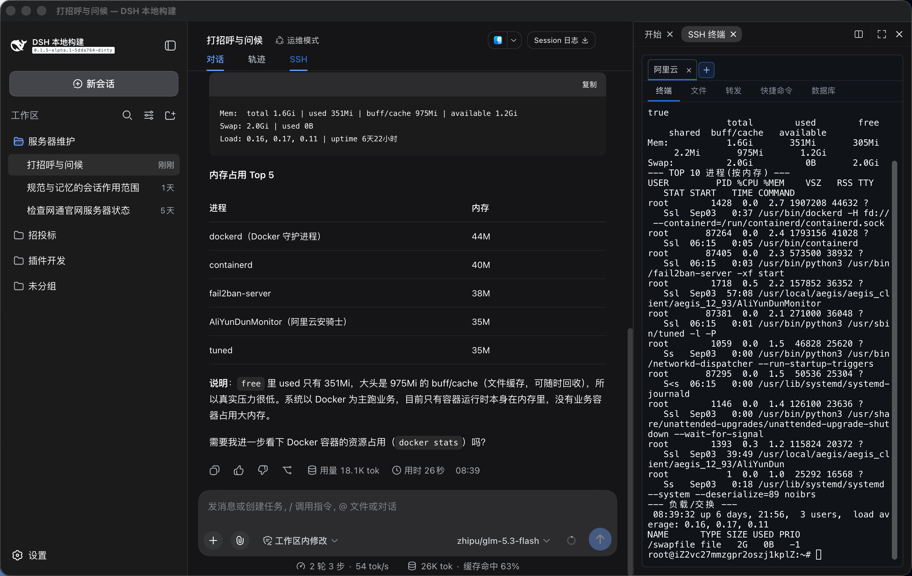
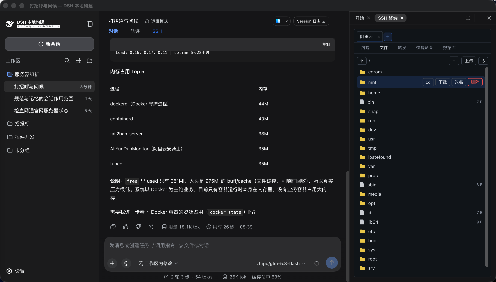

[中文](./product-guide.md) · [English](./product-guide.en.md)

---

# DSH SSH Ops Product Guide

> Drive your servers from the DSH main conversation while keeping a real interactive terminal on the right — plus file management, port forwarding, database access, and multi-server batch execution, all in one plugin.

**Version 0.4.0** · MIT License · [GitHub repository](https://github.com/caoyiwei850/dsh-ssh-ops) · [Releases](https://github.com/caoyiwei850/dsh-ssh-ops/releases)

---

## 1. What it is

**DSH SSH Ops** is an SSH operations plugin for DeepSeek Harness (DSH). Once installed, DSH gains a right-side sidebar tab — a real interactive SSH terminal — and the AI assistant in the main conversation gains a full suite of operations tools (connect, run commands, transfer files, query databases, build tunnels, batch execution) that works alongside you on the same server.

It is not "a command line crammed into a chat box" — it is **two tracks running in parallel**:

- **You**: operate manually in the right-side terminal exactly like any ssh session, with full scrollback and the ability to take over at any moment;
- **The AI**: picks up tasks in the main conversation, runs commands on the server, and every command plus its output is mirrored live into the right-side terminal where you can watch the whole thing.



## 2. Who it is for, and what it solves

| Your situation | What the plugin gives you |
| --- | --- |
| You want AI-assisted ops but fear it deleting things | High-risk command blocklist + deletions go to trash + dangerous SQL is auto-backed-up — the AI can never truly drop your data |
| You are tired of pasting terminal output into a chat and copying commands back | The AI executes directly on the server; commands and output are mirrored live into a real terminal on the right |
| You juggle many machines and retype passwords | Servers managed as resources, credentials encrypted locally, shared credentials updated once for every server that references them |
| Querying an inner-network database means tunnels and extra clients | Database panel connects to MySQL/PostgreSQL/Redis/MongoDB and more; loopback addresses automatically route through the SSH tunnel |
| You need the same command on ten machines | Say "batch execute", tick the target machines, run concurrently with per-server results |
| Deep machines behind a jump host | ProxyJump chains up to 8 hops, plus SSH Agent forwarding so private keys never get spread across bastions |

**Intended users**: backend / ops / data engineers, and anyone who touches servers regularly and wants an AI assistant alongside. No plugin-development knowledge needed; the only prerequisite is knowing your server address and account.

## 3. Feature map

Once installed, the right sidebar gains an **SSH tab** containing five sub-tabs:

| Sub-tab | What it does | Agent tools |
| --- | --- | --- |
| **Terminal** | Interactive PTY terminal: multiple tabs, light/dark theme following, scrollback buffer | `ssh_exec` / `ssh_read` / `ssh_write` |
| **Files** | SFTP file manager: browse, upload/download, drag-and-drop, text editor | `sftp_*` (8 tools) |
| **Tunnels** | Local / remote / SOCKS5 dynamic port forwarding with live status and stop | `tunnel_*` (3 tools) |
| **Database** | Connect to databases, run SQL/commands, tabular results, CSV export | `db_*` (15 tools) |
| **Logs** | Terminal session recording: preview, search, download, delete | `ssh_session_log_*` (3 tools) |

The companion **Settings → SSH Resources** page manages server assets (a first-class entry in the settings menu) with three segments: **Server groups**, **Shared SSH credentials**, and **AI command execution policy**.

The AI in the main conversation gains **40 tools** in total (see the appendix for the full table).

## 4. Installation

### Prerequisites

- **DSH Desktop** (or a Web Profile) installed and running. The plugin uses DSH's bundled Node.js runtime — you do **not** need a system `ssh`, `sftp`, or Node.js.
- The host must provide the newer right-sidebar APIs (`sidebarRightTabs` / `sidebarRight`); the SSH terminal runs as an official sidebar tab with host-managed splitting, zoom, and fullscreen.

### Three ways to install

**GitHub channel (recommended)**:

```bash
dsh plugin --profile web add github:caoyiwei850/dsh-ssh-ops#v0.4.0
```

This installs source and builds automatically during install. Note that pnpm ≥ 10 blocks build scripts of dependencies by default — if the SSH tab does not appear after a restart, go into `node_modules/dsh-ssh-ops/`, run `npm install && npm run build`, and restart (see [INSTALL.md](../INSTALL.md) for details).

**Release tarball**: download the `.tgz` from [Releases](https://github.com/caoyiwei850/dsh-ssh-ops/releases) and run `dsh plugin --profile web add /path/to/dsh-ssh-ops-x.y.z.tgz`.

**Offline review / development**: download the `.zip`, unpack, and `npm install` (the build runs automatically).

### Required: restart

After installing or upgrading, **fully quit and restart DSH** (system tray → right-click → quit). Without a restart the host half of the plugin does not load.

### Upgrading

The plugin's **Settings → SSH Resources → General** section has a self-update bar (version badge, check-for-update, one-click update). SSH resources, trusted host fingerprints, and credentials live in DSH's separate local storage — outside the plugin package — so regular upgrades keep them.

## 5. Ten-minute quick start

### Step 1: Add your first server

**Settings → SSH Resources → New server**: fill in name, host, port, username, and authentication (password / PEM key; key files can be dragged straight into the window). While you are there, pick a **group** (e.g. "production", "staging") for easier filtering later.


Useful advanced options (in the collapsed "Advanced options" section of the form):

- **Project directory**: an absolute path; the resource card gains an "enter project" action that connects and switches straight to that directory;
- **Login command**: replaces the default shell as the terminal session (e.g. `bash -l` when the default shell is incompatible, or to make `tmux attach` your login session);
- **Jump host**: pick another saved server as the proxy, up to 8 hops;
- **SSH Agent forwarding**: lets you keep logging into deeper machines from the jump host using your local keys;
- **Two-factor authentication**: when a device demands `password,publickey` combined authentication, configure a second factor of the opposite type.

Click "**Connect and open**" on the card — the terminal opens on the right. Done.

### Step 2: First connection verifies the host fingerprint

The first connection records the server's public-key fingerprint (TOFU); afterwards a changed fingerprint is rejected — protecting against man-in-the-middle attacks and accidentally connecting to a rebuilt machine. A fingerprint change never auto-retries; follow the prompt to "forget fingerprint" and reconnect.

### Step 3: Let the AI take tasks

Talk to it in plain language in the main conversation:

> "Check memory and disk usage on this machine"
> "Change server_name to api.example.com in the Nginx config, then reload"

The AI sends commands to the currently connected server, and **the commands and their output appear live in the right-side terminal**, with exit code, duration, and working directory reported back. You can take over manually in the terminal at any time.

> ⚠️ **The AI cannot see your saved assets by default**: it cannot enumerate saved servers or connect to them with stored credentials. To let it connect to a saved server by name, turn on **Settings → SSH Resources → AI auto-connect** (every such connection opens a terminal in the right panel, always visible to the operator).

### Step 4: Manage files

The "Files" sub-tab is an SFTP file manager: upload, download, create directories, delete, rename, drag-and-drop upload, a built-in text editor (up to 10 MB), and favorite paths. You can also just tell the AI "download this directory to my machine".



### Step 5: Query databases

Create a connection in the "Database" sub-tab. Seven engines are supported: **MySQL / PostgreSQL / Redis / MongoDB / SQLite / ClickHouse / openGauss**. Key points:

- A loopback address (127.0.0.1 etc.) **automatically routes through the current SSH server's tunnel** to reach inner-network databases — no manual tunneling;
- Three SSL modes (disabled / encrypted-unverified / encrypted + CA verified) to fit managed cloud databases;
- Connections can be saved as resources and restored with one click after a restart.


You can also let the AI do it: `db_query` is a lexically enforced read-only gate (only SELECT/SHOW/DESCRIBE/EXPLAIN/plain WITH queries pass), writes go through `db_execute`, and high-risk SQL (DROP/TRUNCATE/SHUTDOWN) is always blocked and auto-backed-up.

### Step 6 (going further): port forwarding and batch execution

- Build tunnels from the "Tunnels" sub-tab or from the conversation: local, remote, and **SOCKS5 dynamic forwarding** (the `ssh -D` equivalent — one local port becomes a proxy exit);
- Multi-server batch: say "**batch execute** df -h" in the main conversation; the AI creates a batch task, a checkbox dialog opens on the right (listing all saved servers, **including disconnected ones**), and after you confirm, commands run concurrently with results grouped per server.

## 6. Feature walkthrough

### 6.1 Connection management

- **Everything is a resource**: server details (name/host/port/username/auth/group) are saved in DSH local storage with no limit on count; passwords, PEM keys, and key passphrases go only into DSH's official local credential store `~/.dsh/.credentials.yaml` (owner-only permissions) — browser storage, AI context, tool results, and the resource list never read or display secret contents. The new-server form prefills the username you used on your **last save** (`root` when there is no history yet) — no configuration needed; the default simply follows whatever you save.
- **Shared credentials**: save one password/key as a shared credential referenced by multiple servers and jump hosts — the whole team can share one ops key, and changing it once updates everywhere. Deletion is refused while anything still references it.
- **Connection stability**: keepalive (20 s × 3) defeats silent NAT drops; unexpected transport loss reconnects with exponential backoff (capped at 30 s) and commands caught mid-flight transparently retry once; non-conforming SSH banners (e.g. `SSH-2.0- OpenSSH` with an extra space) are normalized and retried once.
- **Network devices**: on Huawei VRP / H3C Comware / Cisco network-CLI devices, `ssh_exec` recognizes prompts, advances paging (`---- More ----`), and treats prompt-return as completion — no more 15-second timeouts returning empty output.
- **Per-pane channels**: with the host's split view, each pane keeps its own servers and connections; the same server opened in two panes builds two independent connections (or check "reuse the open connection" in the connect dialog to share one).
- **Terminal ergonomics**: `Ctrl + wheel` (trackpad pinch works too) zooms every terminal's font size (8–28, remembered across reloads); **copy on select** — text you drag-select in the terminal lands on the clipboard about 0.2 s after you stop; the **Logs** tab tints **warning lines amber and error lines red** while you read a recording (search hits are tinted the same way).

### 6.2 Working with the AI

- **Visible, switchable target**: connections used by the AI carry an "**Agent**" badge; clicking another pane's server label moves the AI over.
- **The main conversation auto-detects** the current connection — no internal connection IDs to hunt for.
- **AI commands are visible**: `ssh_exec` commands appear in the right-side terminal and report exit code / output / cwd / duration / timeout / truncation; when a single idle interactive shell can be confirmed, its working directory is inherited.
- **It does not peek at your terminal**: manual terminal content never silently enters the conversation; when the AI needs it, `ssh_terminal_context` reads a limited, redacted slice per user confirmation.
- **Output redaction**: before anything reaches the model, private keys, Bearer tokens, `sk-` API keys, database passwords, and similar secrets are scrubbed.
- **Session logs**: the "Logs" sub-tab records terminal sessions (preview / search / download / delete; 8 MB per session, 256 MB directory rotation), and the AI has `ssh_session_log_search` and friends for on-demand retrieval.

### 6.2.1 Remote workspace (binding a workspace to a server directory)

Under **Settings → SSH resources → edit a resource → Advanced** (right below the default project directory), bind one DSH workspace to *this server plus an absolute remote path* (say `/srv/app`). The resource editor now has two tabs, **Basics** and **Advanced** — everyday fields on the first, low-frequency knobs like this one on the second. Once bound:

- In that workspace the AI's `sftp_*` calls **default to that remote directory** — relative paths resolve against it (a session sitting in a subdirectory maps to the same depth), the bound server is the default so no `connection_id` is needed, and anything outside the root is refused.
- The conversation states that the workspace's files live remotely, so the AI stops treating the (essentially empty) local directory as the project.
- **No retyping the path**: if this server has a default project directory, the path field offers it as a one-click line right below (`Use the default project directory: /…`). The two fields stay separate on purpose — the project directory decides where *your* "open project" terminal and file tab start, the binding only decides where the AI's `sftp_*` lands — so this just removes the duplicate entry. The line hides itself once the field already matches.
- You may enable "auto-connect on file operations", still gated by the settings switch that allows the AI to connect saved servers; an auto-connected machine is opened in the right-side panel so you always see which server is in play.

**Boundary (important)**: this is not a remote mount. DSH's native `read`/`write`/`edit`/`glob`/`grep` and local bash still run on your own machine — the host mounts exactly one filesystem backend and this plugin does not touch it. Remote reads and writes go through `sftp_*` or `ssh_exec`; `@` completion stays local too. Binding is the **operator's** decision: only the panel can change it, and the AI has no tool for it.

### 6.3 AI command execution policy (important)

This is the dial for how much the AI may do, configured under **Settings → SSH Resources → AI command execution policy**, with three tiers:

| Tier | Behavior |
| --- | --- |
| **Standard** (default) | High-risk commands (file deletion, database destruction, disk formatting, reboot, and five more categories) always escalate to the operator via an in-conversation interruptive approval — nothing runs without a human decision |
| **Custom release** | Choose which of the 8 categories to release (e.g. only "reboot or shut down the server") |
| **Allow all** | The AI executes everything directly — **released commands run as written and deletions no longer go through the trash**; be sure you accept that before enabling |

Ground rules:

- **The AI can never widen the tier itself** — switching is an operator-only action; the AI only receives a structured rejection;
- A session switch (the tier chip at the terminal's bottom-left corner, collapsed to an edge dot by default and expanding on hover) **applies to the current session only**; loosening asks for confirmation; for a per-machine permanent override, use that server's "Advanced options";
- The multi-server batch checkbox **stays tier-independent** — operator confirmation is always required.

The 8 high-risk categories: delete files or directories / bulk-delete files / destroy database data or objects / format or overwrite disks / delete containers, images or volumes / destroy deployed resources / irreversibly clean a code workspace / reboot or shut down the server.

### 6.4 Security model (three layers)

**Layer 1 — blocklist.** Obvious irreversible operations by AI tools (dropping databases, formatting disks, `terraform destroy`, `kubectl delete`, `docker prune`, forced Git cleanups, reboot/shutdown) are blocked outright; the blocklist covers common bypass variants (`find -exec rm`, `xargs rm`, `rimraf`, and one-liners in python/perl/node calling `unlink`/`rmtree`).

**Layer 2 — deletions become reversible.** A simple `rm`/`unlink`/`rmdir`, once confirmed, performs a **recoverable move**: the target goes into `~/.dsh-trash/` on the server with its original path recorded; expired items are truly deleted 24 hours later as a side effect of the next trash write (no cron installed on your server). **AI-initiated deletions never truly happen** — mistakes can be moved back from the trash; permanent deletion is something you do yourself in the terminal (manual input bypasses the interception, by design).

**Layer 3 — dangerous SQL becomes recoverable.** `DROP`/`TRUNCATE`/`SHUTDOWN` never execute; at interception the affected tables are **automatically backed up** (row data via a read-only export path, plus CREATE DDL where available); `DROP TABLE` goes further and becomes an **isolation rename** (`<table>_to_be_dropped_<date>`) — data stays in place and the final true DROP is only ever accepted from the panel, initiated by a human.

When the blocklist triggers, the whole tool call **suspends in the conversation** while the host's native approval channel asks the operator (full command + host + risk category); while waiting, the AI cannot retry, work around, or continue in parallel, and an absent operator counts as rejection (fail-closed). An approval is one-shot and burns on use; if the command was dispatched but the connection drops before a result arrives, the system never replays it automatically and instead asks the operator to verify the actual outcome.

### 6.5 Database engineering

- `db_query` is a lexically enforced **true read-only gate**: blocks write-verb subqueries, PG data-modifying CTEs, `SELECT INTO`, and `FOR UPDATE` locking reads; keywords inside string literals are never misfired on;
- Streaming truncation defaults to 200 rows + 30 s timeout (environment variable `DSH_SSH_OPS_MAX_DB_ROWS` raises it up to 5000); a per-connection `query_timeout_ms` widens the deadline for slow databases (`0` = unlimited);
- Interactive transactions `db_tx_begin/execute/commit/rollback` (exclusive connection, auto-rollback after 5 minutes idle);
- `db_describe_table` (columns/indexes/foreign keys/DDL/row counts), `db_explain` (execution plans), `db_preview` (paged sampling), `db_export` (CSV/JSON export, optionally written to the server over SSH and picked up from the Files tab);
- Panel side: table tree, preview view, one-click CSV export (with BOM for Excel compatibility), 50-entry query history.

### 6.6 UI language

The interface automatically follows DSH's own language (Chinese / English), redrawing immediately on switch. If the host runs a language the plugin does not ship (e.g. Russian), it falls back to Chinese — such environments can pin the language in the settings file (`~/.dsh/storages/ssh_ops_settings.json`) with `autoApplySystemLanguage: false` + `language` (edit while DSH is stopped).

## 7. Ready-made recipes

**Pre-release inspection** — "Connect to prod-web-1 and check disk, memory, and the last 100 lines of the app log for errors"; inspection commands are ordinary ops operations and run normally.

**Tracking down a full disk** — the AI runs `df -h` to locate, drills down with `du`, and when it proposes deleting large files an approval request pops up; you click "Approve" and the files go to the trash instead of being deleted — clean the trash once the business confirms all is well.

**Inner-network database behind a jump host** — configure the jump host on the server resource → put the inner loopback address in the database connection → it connects through the SSH tunnel automatically; `db_query` from there.

**Rolling a change across 20 machines** — "batch execute `cat /etc/os-release | head -1` first to see the OS versions" → tick targets → verify per-server results → then batch the actual change.

**A temporary proxy exit for a colleague** — "build a SOCKS5 dynamic forward on jump-server, local port 1080" → the tunnel appears in the Tunnels tab; stop it with one click when done.

**Back up a table before touching its structure** — issue `DROP TABLE` via `db_execute` → the plugin intercepts, auto-backs-up CSV + DDL, and isolates the table under a new name → after you confirm it is safe, perform the final deletion yourself from the panel.

## 8. FAQ

**No SSH tab after installing?**
① Did you fully quit and restart DSH? ② On the GitHub channel with pnpm ≥ 10, check whether `node_modules/dsh-ssh-ops/lib/` exists (missing = build script blocked; go into the package and run `npm install && npm run build`).

**The AI says it "cannot enumerate saved resources"?**
Expected. Turn on **Settings → SSH Resources → AI auto-connect** before the AI can connect to saved servers by name.

**The AI wanted to delete something and was blocked — but it is safe. What now?**
Click "Approve" on the in-conversation confirmation yourself — simple deletions then go to the trash (recoverable); or release that category in the execution policy; or run it yourself in the terminal.

**Authentication fails?**
The plugin returns a structured diagnosis (methods tried, what the server still accepts, next steps). Common causes: a truncated private key, the public key missing from the server's `authorized_keys`, or an encrypted key's passphrase pasted into the password field.

**The terminal froze / stopped responding?**
Usually a host restart killed the old SSH session, leaving a frozen picture. Close that terminal tab and open a fresh one.

**Rejected because of a fingerprint change?**
First make sure it is not a man-in-the-middle and you are not hitting a rebuilt machine; then "forget fingerprint" under **Settings → SSH Resources → trusted hosts** and reconnect.

**Big database queries get cut off at 30 seconds?**
Set `query_timeout_ms` on the connection (`0` = unlimited), and save it in the resource.

## 9. Appendix: all 40 agent tools

Omitting `connection_id` / `db_connection_id` targets the currently active connection — no need to list connections first.

**SSH session (7)**: `ssh_list` connection metadata plus (when enabled) saved servers · `ssh_connect` open a connection · `ssh_connect_profile` connect to a saved resource by name (requires the AI auto-connect switch) · `ssh_exec` run a command · `ssh_read` incremental terminal read (by default only output since the previous read; `mode: "tail"` for the full capture) · `ssh_write` write interactive input to the terminal · `ssh_disconnect` disconnect

**Manual terminal context (3)**: `ssh_terminal_sessions` terminal metadata and read cursors · `ssh_terminal_context` per-confirmation redacted history · `ssh_shell_integration` enable OSC 133 integration in bash/zsh (afterwards cwd / exit code / prompt state become readable)

**Session logs (3)**: `ssh_session_log_list` / `ssh_session_log_read` / `ssh_session_log_search`

**SFTP (8)**: `sftp_list` · `sftp_read` (4 MiB default cap) · `sftp_write` · `sftp_mkdir` · `sftp_delete` (never executes directly — requires host in-conversation approval; simple literal paths move to the trash when possible) · `sftp_rename` · `sftp_upload_dir` · `sftp_download_dir` (batch tree transfer; small files concurrent, large files exclusive, single-file failures never abort the batch)

**Port forwarding (3)**: `tunnel_start` (`local` / `remote` / `dynamic` SOCKS5) · `tunnel_list` · `tunnel_stop`

**Batch execution (1)**: `ssh_batch` — use only when the user explicitly asks for multi-server batch; runs after operator checkbox confirmation

**Database (15)**: `db_connect` · `db_list_connections` · `db_query` (enforced read-only) · `db_execute` (writes; high-risk blocked + backed up) · `db_list_tables` · `db_describe_table` · `db_preview` · `db_explain` · `db_export` · `db_run` (Redis commands / MongoDB operations) · `db_disconnect` · `db_tx_begin` / `db_tx_execute` / `db_tx_commit` / `db_tx_rollback`

---

*This document matches v0.4.0; for the fine detail consult the [README](../README.en.md) and the [CHANGELOG](../CHANGELOG.md).*
